# 3rd Infodengue-Mosqlimate Dengue Challenge (IMDC)
## Ensemble Models Results

**Organization:**  

**Funding:**  

This file presents the results of the ensemble forecasts generated from submitted dengue forecasting models for the state-level **mandatory challenge** of the 2026 IMDC.

---

## Teams and models

Of the 28 models submitted for the dengue state-level challenge, 6 did not submit forecasts, and 1 was designated as the baseline, leaving 21 models for the analysis. The models included in the analysis are listed in the table below. **The BB model was used as the baseline for comparison.**

| Team | Institution | Country | Repository | Label in plots |
|------|-------------|---------|------------|---------------|
| Global Health Resilience (GHR)* | Barcelona Supercomputing Center | Spain | https://github.com/dievillano/3rd_imdc_bsc_ghr | BSC |
| Cornell-PEH | Cornell University | United States | https://github.com/BentoLab-DiseaseDynamics/3rd_imdc_cornell_bentolab| CORNELL | 
| LNCC ARP26 | Laboratório Nacional de Computação Científica | Brazil | https://github.com/pesquefGH/3rd_imdc_lncc_lncc_arp26_dengue | LNCC_ARP26 | 
| LNCC SURGE | Laboratório Nacional de Computação Científica | Brazil |https://github.com/pesquefGH/3rd_imdc_lncc_surge_model26_dengue | LNCC_SURGE | 
| LNCC CLIDENGO | Laboratório Nacional de Computação Científica | Brazil |https://github.com/americocunhajr/3rd_imdc_lncc_clidengo26dengue | LNCC_CLIDENGO | 
| Epidemáticos - Prophet* | FGV-EMAp | Brazil | https://mosqlimate.org/EzequielEBS/3rd_imdc_emap_epidematicos_prophet_fixed | EMAP_PROPHET | 
| Epidemáticos - Sarimax* | FGV-EMAp | Brazil | https://mosqlimate.org/EzequielEBS/3rd_imdc_emap_epidematicos_sarimax_fixed | EMAP_SARIMAX | 
| InfraMIND | IFGW Unicamp and BIFI Universidad de Zaragoza | Brazil | https://github.com/InfraMIND-models/3rd_imdc_ifgw_inframind-proteus | IFGW | 
| ISI Dengue | ISI Foundation | Italy | https://github.com/mattiamazzoli/3rd_imdc_isi_isi-dengue | ISI | 
| MARD | Fiocruz | Brazil | https://github.com/asgouveiaa/3rd_imdc_fiocruz_mard | FIOCRUZ_MARD |
| Return of the Forecast | Centre for Epidemic Response & Innovation (CERI) | South Africa | https://github.com/CERI-KRISP/CERI_Dengue_Forecasting_2026 | CERI | 
| NOIS PUC Arbocaster | Pontifical Catholic University of Rio de Janeiro (PUC-Rio) | Brazil | https://github.com/Dududidicao99/3rd_imdc_pucrio_arbocaster | PUCRIO | 
| XGBSillas | FGV-EMAP | Brazil | https://github.com/scrocha/3rd_imdc_emap_xgbsillas | EMAP_XGB |
| SAKHAL | FGV-EMAP | Brazil | https://github.com/marciomacielbastos/3rd_imdc_fgv_sakhal | EMAP_SAKHAL |
| Pattern-Blue | FGV-EMAP | Brazil | https://github.com/ZuilhoSe/3rd_imdc_fgv_pattern-blue | EMAP_BLUE | 
| Dengue Oracle | FGV-EMAP | Brazil | https://github.com/eduardocorrearaujo/3rd_imdc_emap_lstm | EMAP_LSTM | 
| Neural Earth | Purdue University | United States |https://github.com/kamrul28890/3rd_imdc_purdue_neuralearth | PURDUE | 
| BB model | Fiocruz | Brazil |https://github.com/lsbastos/3rd_imdc_procc_bb_model| PROCC| 
| DS-OKSTATE-26 | Oklahoma State University | United States |https://github.com/haridas-das/DS-OKSTATE-2026| DS-OKSTATE| 
| NUS CERM| National University of Singapore | Singapore |https://github.com/SungmokJung/3rd_imdc_nus_nus-cerm| NUS-CERM| 
| AFYA| Afya | Brazil |https://github.com/Ricafya/3rd_imdc_afya_ric| AFYA| 
| Mosqlimate AI | FGV-EMAP | Brazil | https://github.com/fccoelho/mosqlimate-ai-competitor | EMAP_TIMESFM |

*The validation forecasts for these models have been updated following the identification of inconsistencies in the workflow used to generate them.

---

## The Ensemble

### Model Ranking Methodology 

Model performance was evaluated using the ratio between each model's **Weighted Interval Score (WIS)** and the WIS of a **baseline model**.

For each validation period $v$, the performance ratio was computed as

$$R_v = \frac{\mathrm{WIS}_{\mathrm{model},v}}
{\mathrm{WIS}_{\mathrm{baseline},v}}.$$

* $R_v < 1$: model outperforms the baseline.
* $R_v > 1$: model performs worse than the baseline.

To obtain a single score for each state, the **geometric mean** of $R_v$ across the four validation periods was computed. Models were then ranked within each state according to this value, with **lower values indicating better predictive performance**.

### Forecast Puzzle

The figure below shows, for each row, the rank of the model corresponding to the column name within each validation set, based on the geometric mean of the wis ratio. For each state, the model with the lowest geometric average across the four validation periods was selected (column name). The figure illustrates that model performance can vary between validation years, as observed for states such as MG and BA. This lack of consistency in model performance, combined with the limited number of validation samples, informed the methodology used for constructing the ensemble.

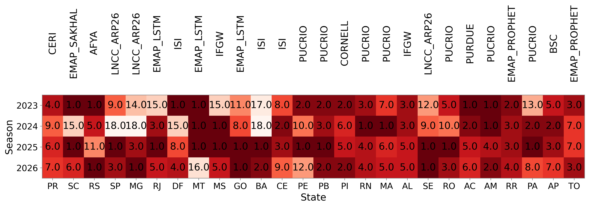  

---

### Ensemble Method

Following the [COVID Hub methodology](https://doi.org/10.1016/j.ijforecast.2022.06.005) we computed the median of predictive intervals from each model. Since the results were similar to those obtained from logarithmic pooling with equal weights, we opted for the **median**, which does not need a parametric approximation.

---

### Inclusion Criteria

Evaluating Ensemble Performance as a Function of Size

* Analyzed changes in the WIS ratio between the ensemble and the baseline as the top (K) models were progressively added, ranked by performance in previous validation seasons.

* Conducted the analysis separately for each validation set.

* Summarized results by plotting the proportion of state–validation set pairs in which the ensemble outperformed the baseline $(\mathrm{WIS}_{\text{ensemble}} / \mathrm{WIS}_{\text{baseline}} < 1)$ for each ensemble size (K).

In the figure below, each line represents a state. The x-axis shows the number of models included in the ensemble, while the y-axis shows the WIS ratio between the ensemble and the baseline. Models are added in order of their performance on previous validation sets.

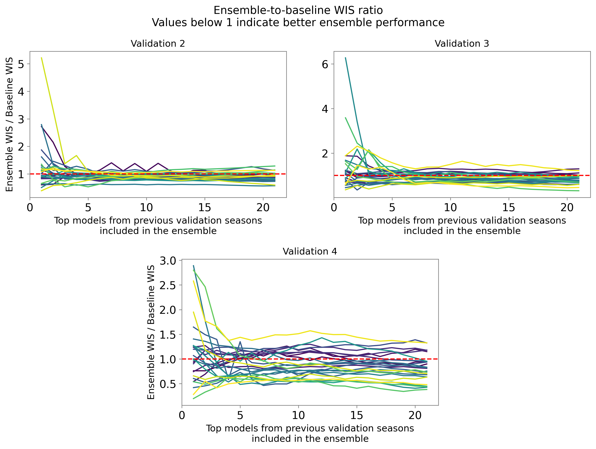  

To summarize the results shown in the figure above, we calculated, for each ensemble size, the proportion of state–validation pairs for which the WIS ratio between the ensemble and the baseline was below 1, indicating better performance by the ensemble. This analysis was used to determine a cutoff for the number of models to include in the ensemble. Based on these results, we selected the **top 10 models for inclusion in the ensemble**.

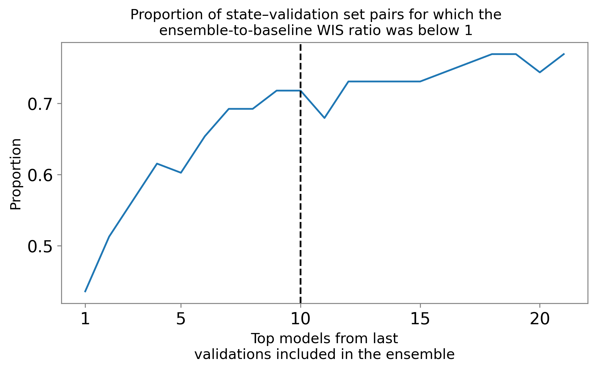  

---

## Results

#### Brazil (National)

The figure below presents the median and confidence interval of 90% of the total cases computed for the 2026-2027 season against the number of cases notified up to EW 202639.

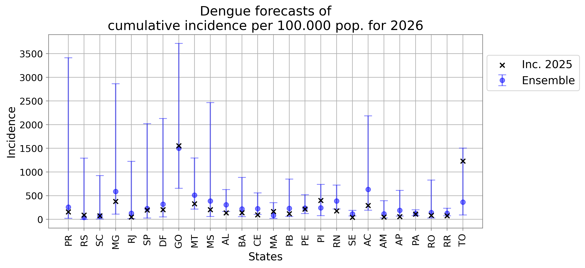

The map and table below show, by state, the percentage ratio between the cumulative incidence predicted by the median of the ensemble model (2026-2027 season) and the cumulative incidence observed during the 2025-2026 season.

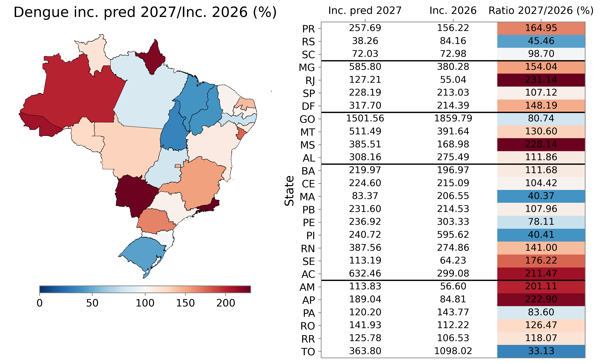

### Regional Results

The panels below show results for each state, grouped by macroregion. In each section, the first panel represents the weekly incidence, and the second panel shows the cumulative incidence. Within the panels, the median ensemble predictions are displayed as dashed blue lines, the median predictions of the best model for each state as solid red lines, predictions from the other models as solid grey lines, and the incidence from the previous season as dotted black lines. The cumulative incidence was computed by summing the median predictions; therefore, it does not include prediction intervals.

#### South Region
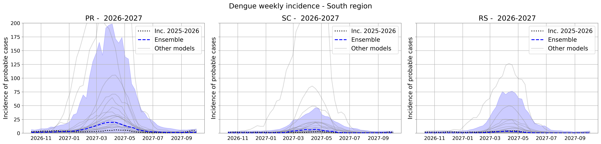  
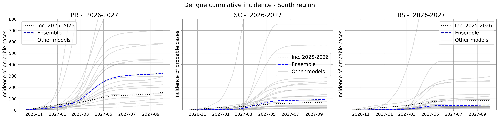

#### Southeast Region
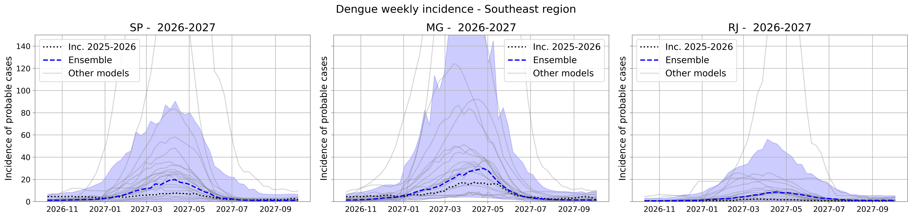  
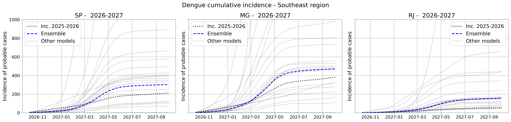

#### Midwest Region
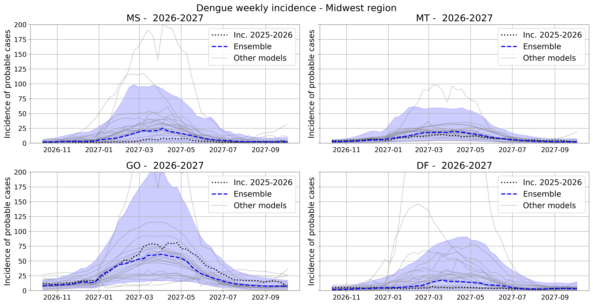  
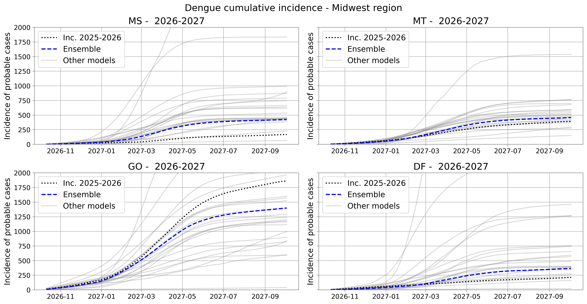

#### Northeast Region
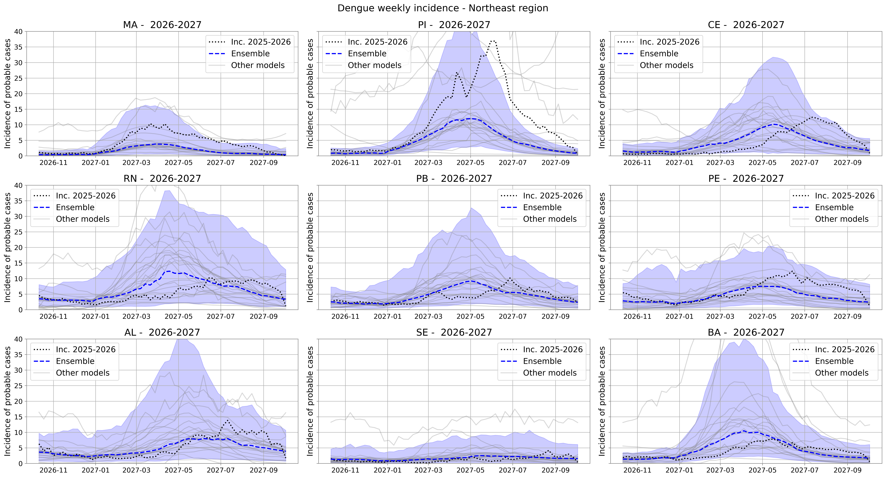  
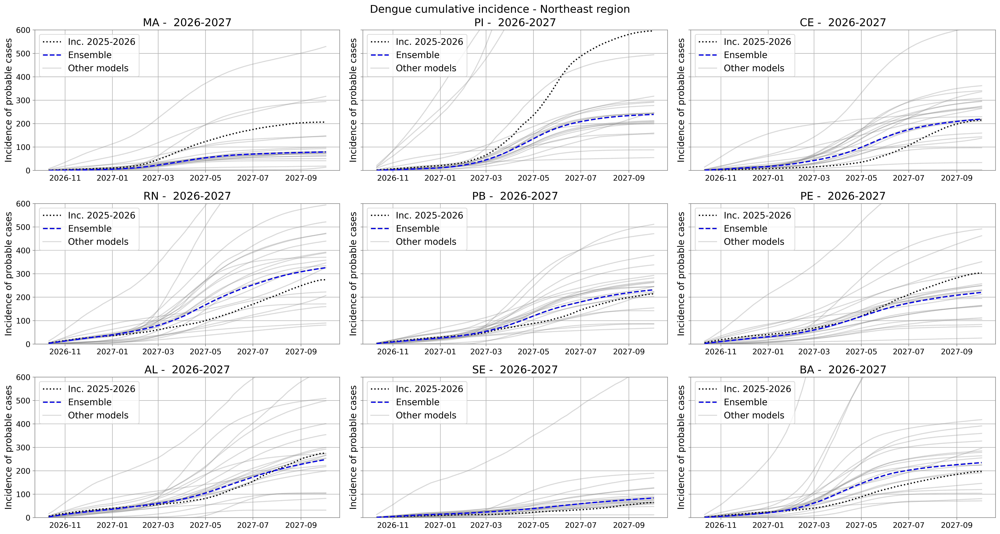

#### North Region
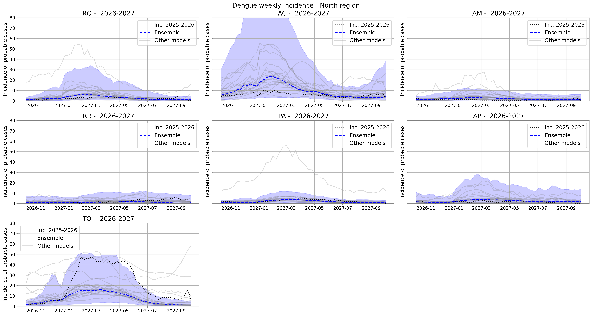  
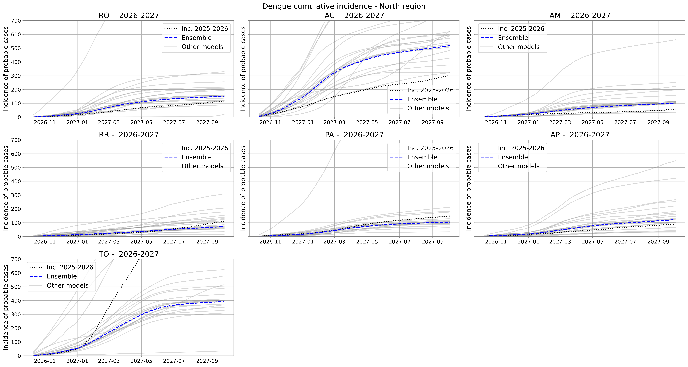

---

### Important Dates

> **Save these dates!**
> 1. Webinar presenting results for the Brazilian Ministry of Health — **November 06, 2026**

